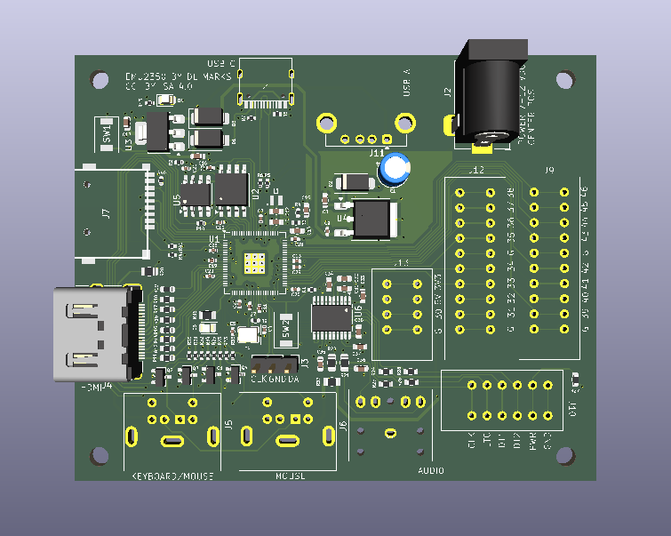

# EmuBoard2350

By Daniel L. Marks

This is an economical layout of a [FRANK](https://github.com/rh1tech/frank)-type multiemulator board,
intended to be manufactured by JLCPCB PCBA on a four layer board, using mostly basic parts.
It is both intended to be a fun gaming platform and a good educational project.
Extra pins of the RP2350B are exposed so that it may be usable for other projects, and there
are through-hole part components that are left unpopulated for learning soldering.

The major deviation from the FRANK design is that the NES pins are brought to a header rather
than a DE-9 male connector.  This was done because already-built famiclone-type controllers could
not be found.  Instead, the pins are brought to KF141V spring terminals, and a replacement
NES controller may have its connector removed and wires inserted into the terminals, or a
custom connector may be used.  A barrel jack is also provided so a standard wallwart that
one might have from another device may be used for power.

To support more than one USB device, an external USB hub needs to be plugged into the USB A
socket, for example when using a keyboard and a mouse.

